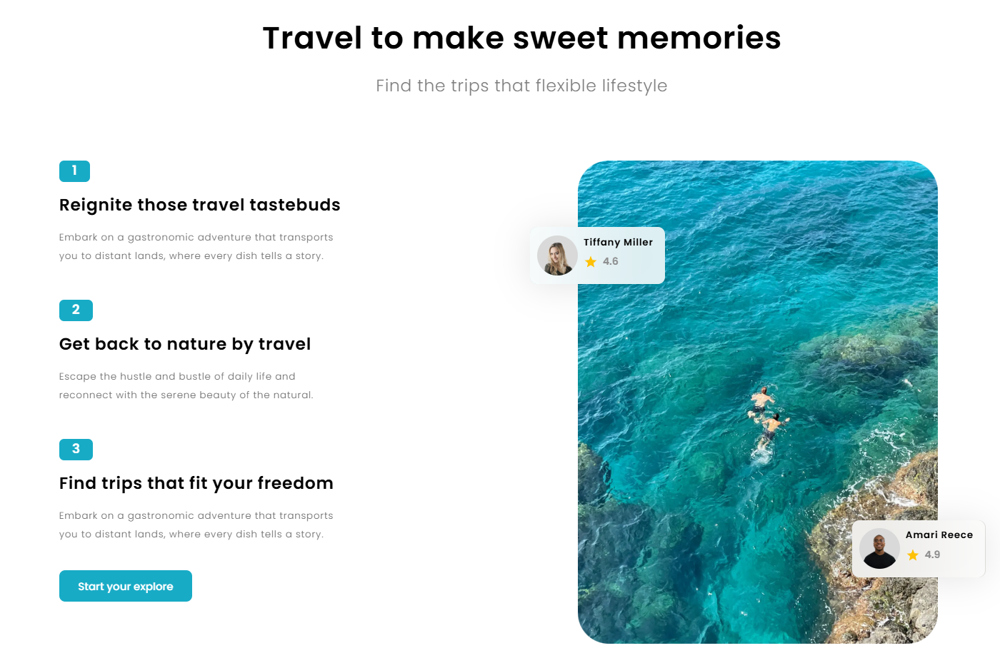
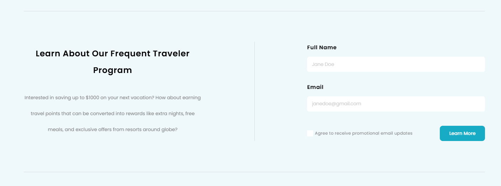

# Travel Landing Page

A modern, responsive travel landing page built with React, TypeScript, and Tailwind CSS. Designed to showcase travel experiences, services, and destinations through a clean and engaging user interface.

## Live Demo

[**View Live Demo**](https://gotravel-landingpage.netlify.app/)

## Screenshots

### Beginning


### Middle



### Form



### Footer


## Features

- **Hero Section** – Engaging introductory section highlighting travel experiences.
- **Navigation** – Responsive navigation with a dedicated mobile menu.
- **Travel Services** – Sections showcasing travel services and available experiences.
- **Explore More** – Additional travel-related content and destinations.
- **Travel News** – Section featuring travel-related articles and updates.
- **Testimonials** – Customer feedback section to build credibility.
- **Contact Form** – Form section for user inquiries.
- **Responsive Design** – Optimized layouts for desktop, tablet, and mobile devices.
- **Reusable Components** – Modular React components for maintainable code.

## Tech Stack

| Technology     | Purpose                               |
| -------------- | ------------------------------------- |
| React 19       | Component-based user interface        |
| TypeScript     | Static typing and maintainability     |
| Vite           | Development server and build tooling  |
| Tailwind CSS 4 | Utility-first styling                 |
| TanStack Query | Asynchronous data management          |
| Motion         | Animations and interactive UI effects |
| Supabase       | Backend services integration          |

## Getting Started

Follow these instructions to run the project locally.

### Prerequisites

- [Node.js](https://nodejs.org/) (LTS recommended)
- npm
- Git

### Installation

1. Clone the repository:

   ```bash
   git clone https://github.com/JackyL1030/Travel-Landing-Page.git
   ```

2. Navigate to the project directory:

   ```bash
   cd Travel-Landing-Page
   ```

3. Install dependencies:

   ```bash
   npm install
   ```

4. Start the development server:

   ```bash
   npm run dev
   ```

5. Open the local URL provided in your terminal to view the application.

## Available Scripts

| Command           | Description                           |
| ----------------- | ------------------------------------- |
| `npm run dev`     | Starts the development server         |
| `npm run build`   | Builds the application for production |
| `npm run preview` | Previews the production build locally |
| `npm run lint`    | Runs ESLint                           |
| `npm run deploy`  | Builds and previews the application   |

## Project Structure

```text
Travel-Landing-Page/
├── public/                 # Static assets and images
├── src/
│   ├── components/         # Reusable UI components
│   ├── contexts/           # React context providers
│   ├── utils/              # Utility functions and content
│   ├── App.tsx             # Main application component
│   └── ...
├── index.html
├── package.json
├── tsconfig.json
└── vite.config.ts
```

## Learning Objectives

- Building reusable and maintainable React components.
- Developing applications with TypeScript.
- Creating responsive layouts using Tailwind CSS.
- Organizing frontend projects with a modular architecture.
- Managing asynchronous data with TanStack Query.
- Implementing shared state using React Context.
- Working with modern frontend development tools.

## Author

**Jacky Lai**

- GitHub: [@JackyL1030](https://github.com/JackyL1030)
- Live Demo: [Travel Landing Page](https://gotravel-landingpage.netlify.app/)
